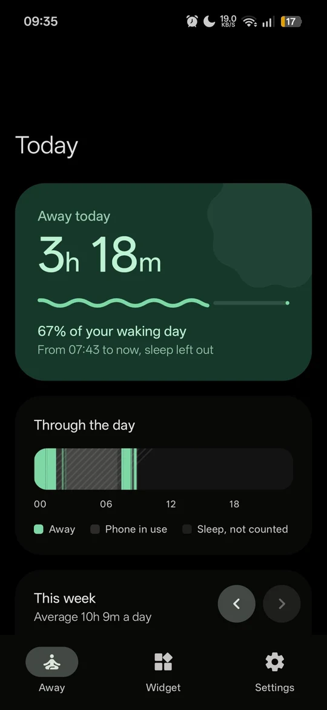
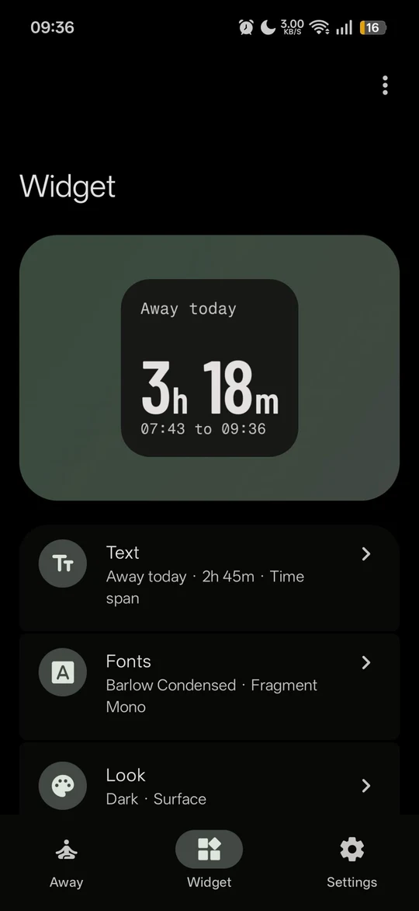

<h1 align="center">Hiatus</h1>

How long you've been away from your phone today. A home-screen widget and an analytics page for Android, in Material 3 Expressive.

<a href="../../releases/latest"><b>Download the latest APK</b></a>

  
  &nbsp;&nbsp;
  

Hiatus counts the time you *didn't* use your phone. The widget shows today's total at a glance; the app shows
your breaks, how often you check your phone, and which apps pull you back. Everything is read on the phone from
Android's usage events. Nothing leaves the device.

**Away** means the phone wasn't unlocked. Glancing at the lock screen doesn't count as use.

## Features

**Widget**
- "Away today" as one big number, with the time span it covers underneath ("From 7:12 AM to 4:25 PM")
- Fits any size from 1 × 1 up; the layout adapts to small, wide and tall widgets
- Pick the label, what's under the number and the number format (e.g. 4h 12m or 4.2h)
- Separate fonts for the number, label and caption: system, any Google Font, or your own font file, each with weight and size
- Theme, background (surface, tinted or clear) and an optional thin clock in the corner
- Tap to open Hiatus, open another app, or refresh

**Home**
- Away today and its share of your day, with the day drawn as a strip
- This week, with arrows back through earlier weeks
- Breaks: longest, average, count, last one, and by length
- Check-ins: unlocks, how often, first and last, and by hour
- Apps: the ones you use most, and the ones you open first after unlocking

**Settings**
- Shortest break that counts, and leaving out sleep (off, automatic, or set hours)
- Theme (System / Light / Dark), pure black, and the app's font

**Also**
- History is kept on the phone, so past weeks outlive Android's own week of usage data
- Updates from inside the app: a card on Home when a new version is out; one tap downloads and installs it

## Install

Download `Hiatus-x.y.z.apk` from the [latest release](../../releases/latest) and open it on your phone. Hiatus
asks for **Usage access** and takes you to the setting. On OnePlus/OxygenOS, set battery use to *Unrestricted*
so the widget updates promptly after you unlock. What changed in each version is in [CHANGELOG.md](CHANGELOG.md).

## Part of a family

Four small Android apps built to look and behave like one set: same icon palette, Material 3 Expressive with your
wallpaper's colours, pure black mode, any Google Font for the app, the same settings layout, and in-app updates
from GitHub Releases.

| | |
|---|---|
| [**Aria**](https://github.com/savar95x/aria-player) | Music player for your local files |
| [**Minutia**](https://github.com/savar95x/minutia) | Clock widget where every detail is yours |
| [**Hiatus**](https://github.com/savar95x/hiatus) | How long you've been away from your phone |
| [**Regista**](https://github.com/savar95x/regista) | Reminders for the football matches you care about |

## Building

GitHub Actions builds every push. Bumping `VERSION_NAME` in `version.properties` with a matching
`CHANGELOG.md` section publishes a release. Working on it with an AI agent? Start with [CLAUDE.md](CLAUDE.md).
